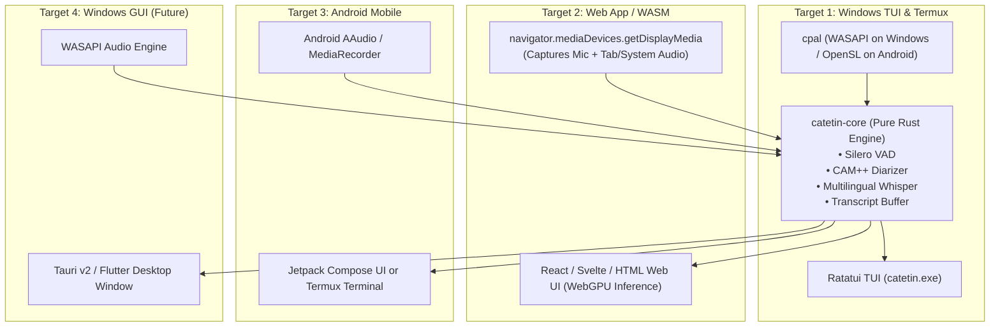

# Cross-Platform Architecture: One Core Engine, Any UI Wrapper

**Project:** **Catetin** (`catetin`) — *"Tolong catetin rapat ini ya!"*

**Vision:** A single, unified backend codebase that compiles to:
1. **Web App / WASM** (Runs in modern browsers via WebAudio + WebGPU)
2. **Windows TUI** (Native, high-performance terminal UI via WASAPI)
3. **Android** (Termux CLI directly, or wrapped via JNI into a simple Android UI)
4. **Windows GUI** (Optional future wrapper via Tauri / Flutter)

---

## 1. The Language Decision: Why Rust is the Undisputed Winner

To achieve true "one codebase compiled to WASM, Windows, and Android", **Rust** is the industry standard:

| Requirement | Rust | C++ | Go | TypeScript / JS |
| :--- | :--- | :--- | :--- | :--- |
| **WASM / WebGPU Target** | ⭐ **Native (`wasm32-unknown-unknown` + `wasm-bindgen`)** | Good (Emscripten, but cumbersome) | Poor (Heavy runtime) | Native (Browser only) |
| **Windows Native Performance** | ⭐ **Zero-cost, native `.exe`** | ⭐ Native `.exe` | Native `.exe` | Needs Node/Electron |
| **Android / Termux Support** | ⭐ **`cargo ndk` or native Termux build** | Native NDK | Gomobile (clunky) | Node in Termux |
| **Audio Ecosystem** | ⭐ **`cpal` (Supports WASAPI, WebAudio, Android AAudio)** | PortAudio / Miniaudio | Malgo (wrapper) | WebAudio only |
| **Speech & AI Ecosystem** | ⭐ **`whisper-rs`, `ort`, `candle`** | `whisper.cpp`, ONNX Runtime | CGO wrappers | Transformers.js |
| **Single Tooling / Cargo** | ⭐ **One `Cargo.toml` workspace** | CMake / vcpkg nightmare | Standard Go | npm / packaging |

---

## 2. The "Clean Core" Architecture (Cargo Workspace)

We structure the project as a **Cargo Workspace**: the core engine knows **nothing about UIs**; it only accepts PCM audio buffers and emits structured events.

```
catetin/
├── Cargo.toml                      # Workspace root
├── crates/
│   ├── catetin-core/               # <-- THE SINGLE CORE ENGINE (Platform-agnostic)
│   │   ├── Cargo.toml
│   │   └── src/
│   │       ├── audio/              # VAD + Normalization
│   │       ├── diarization/        # CAM++ Voiceprint Embedding & Cosine Clustering
│   │       ├── asr/                # Multilingual Whisper (whisper.cpp / ONNX)
│   │       ├── buffer/             # In-memory time-stamped transcript ring buffer
│   │       └── events.rs           # TranscriptEvent { speaker, text, timestamp }
│   │
│   ├── catetin-cli/                # Windows & Termux TUI Frontend (Ratatui, command: `catetin`)
│   │   ├── Cargo.toml
│   │   └── src/main.rs             # Wires WASAPI/Audio -> Core -> Ratatui Screen
│   │
│   ├── catetin-wasm/               # Web App Frontend (WebAssembly / WebAudio)
│   │   ├── Cargo.toml
│   │   └── src/lib.rs              # Exports JS bindings for Browser (wasm-bindgen)
│   │
│   └── catetin-android/            # Android JNI / NDK Wrapper
│       ├── Cargo.toml
│       └── src/lib.rs              # Generates .so library for Kotlin / Jetpack Compose
```

---

## 3. How Each Target Operates with the Same Core



---

## 4. Platform-by-Platform Implementation Details

### Target 1: Windows TUI (Our Primary Desktop Build)
* **Audio Capture:** `cpal` crate using WASAPI loopback (`AUDCLNT_STREAMFLAGS_LOOPBACK`) for meeting sound and default capture for the microphone.
* **ASR & Diarization:** Links `whisper-rs` (Whisper.cpp) and `ort` (ONNX Runtime for CAM++).
* **UI:** `ratatui` + `crossterm`.
* **Output:** Single static `catetin.exe` (< 20 MB binary + models).

### Target 2: Web App / WebAssembly (In-Browser Execution)
* **Audio Capture in Browser:**
  * Uses standard Web APIs:
    * `navigator.mediaDevices.getUserMedia({ audio: true })` $\rightarrow$ Captures your Mic.
    * `navigator.mediaDevices.getDisplayMedia({ audio: true, video: true })` $\rightarrow$ Captures System / Meeting tab audio directly from Google Meet or Zoom Web!
* **Running Models in Browser:**
  * Whisper and VAD run **100% inside the browser** using **WebGPU** / WebAssembly via `ONNX Runtime Web` (`ort-web`) or `whisper.wasm`.
  * No server needed—the user opens an HTML page, and their browser downloads and runs the model locally!

### Target 3: Android (Termux or Native App)
* **Termux CLI:**
  * The exact same `catetin-cli` crate can be compiled natively inside Termux on Android using `cargo build --release` (or cross-compiled with `cargo ndk --target aarch64-linux-android`).
  * Runs directly in the Termux shell!
* **Native Android App (Simple UI):**
  * `catetin-android` uses `uniffi-rs` to automatically generate Kotlin bindings from the Rust core.
  * In Kotlin/Jetpack Compose, you just call:
    ```kotlin
    val catetin = CatetinCore.init(whisperModelPath)
    catetin.feedAudio(audioBytes)
    catetin.subscribeEvents { event ->
        println("${event.speaker}: ${event.text}")
    }
    ```

### Target 4: Windows GUI (Optional Future)
* Because `catetin-core` is a clean library, if you ever decide you want a graphical window, you simply build a **Tauri v2** shell. Tauri is written in Rust, so it links directly to `catetin-core` with zero overhead.

---

## 5. Summary & Next Steps

1. **Start with `crates/catetin-core` + `crates/catetin-cli` (Windows TUI).**
   * This proves the dual audio capture, Whisper transcription, and CAM++ diarization first on Windows.
2. **The core remains 100% headless:**
   * It takes raw `&[f32]` audio slices and emits `TranscriptEvent`.
3. **Adding Web/Android later requires zero rewrite of AI/audio logic:**
   * You just write the audio feeder and UI display for each target.
