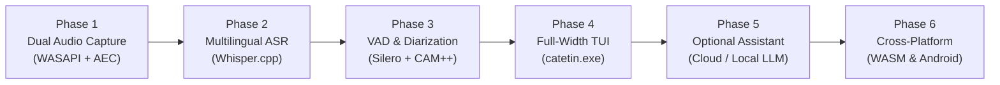

# Catetin: Step-by-Step Development Roadmap

This plan breaks down the construction of **Catetin** into six self-contained, testable phases. Each phase builds upon the previous one and concludes with a verifiable milestone.

---

## Roadmap Overview



---

## Phase 1: Dual Audio Capture Engine (The Foundation)

**Objective:** Capture the user's microphone and meeting output (speakers) simultaneously with zero third-party drivers and zero audio bleed.

* **Tasks:**
  1. Initialize Cargo workspace:
     * `catetin/Cargo.toml`
     * `crates/catetin-core/`
  2. Implement dual-channel capture using the `cpal` crate:
     * **Stream 1 (Near-End):** Default communication microphone (`eCapture`).
     * **Stream 2 (Far-End):** Default render loopback (`AUDCLNT_STREAMFLAGS_LOOPBACK`).
  3. Integrate Acoustic Echo Cancellation (**WebRTC AEC3** or **SpeexDSP**):
     * Loopback audio is fed as the reference signal to cancel speaker noise from the microphone stream.
  4. Resample both streams to 16,000 Hz, 16-bit Mono PCM using `miniaudio` / `rubato`.
* **Milestone / Verification:**
  * Build a test CLI: `cargo run -p catetin-core --example record_test`
  * Play loud music or a meeting on YouTube while speaking into the mic for 10 seconds.
  * Output two clean WAV files: `mic_clean.wav` (contains **only your voice**, zero music leakage) and `meeting.wav` (contains the YouTube audio).

---

## Phase 2: Offline Multilingual Speech-to-Text (ASR)

**Objective:** Transcribe 16 kHz audio streams into English and Indonesian in real time on the local CPU/GPU.

* **Tasks:**
  1. Integrate `whisper-rs` (C++ `whisper.cpp` statically linked into Rust).
  2. Download and bundle the multilingual model:
     * `ggml-whisper-small.bin` (~466 MB) or `whisper-base.bin` (~142 MB).
  3. Implement an audio ring buffer feeding 16 kHz PCM slices into Whisper.
  4. Configure Whisper decoder parameters:
     * `language = "auto"`
     * `translate = false` (keep verbatim speech)
     * Enable streaming greedy search.
* **Milestone / Verification:**
  * Build a test CLI: `cargo run -p catetin-core --example transcribe_test`
  * Speak into the microphone in Indonesian (*"Halo, ini uji coba sistem transkripsi bahasa Indonesia"*).
  * Verify terminal prints real-time text with $< 350\text{ ms}$ latency and accurate Indonesian spelling.

---

## Phase 3: VAD & Speaker Diarization ("Who is Speaking?")

**Objective:** Filter silence and separate voices into `[You]` vs. `[Speaker 1]`, `[Speaker 2]`.

* **Tasks:**
  1. **Voice Activity Detection (VAD):**
     * Integrate `ort` (ONNX Runtime in Rust) loading `silero_vad.onnx` (1.8 MB).
     * Discard non-speech buffers (keyboard clicks, silence).
  2. **Channel-Based Diarization (Tier 1):**
     * Any speech burst originating from the Mic channel is labeled **`[You]`** (100% deterministic).
  3. **Acoustic Diarization on Loopback (Tier 2):**
     * Integrate `cam++_voiceprint.onnx` (18 MB) via `ort`.
     * For each speech burst on the loopback channel, extract a 192-dimensional vector.
     * Implement online cosine clustering:
       * If $\text{cosine\_similarity} > 0.72$, assign to existing speaker.
       * Otherwise, register a new speaker (`Speaker 1`, `Speaker 2`).
  4. Emit unified `TranscriptEvent`:
     ```rust
     pub struct TranscriptEvent {
         pub timestamp: String,
         pub speaker: SpeakerId, // LocalUser, Remote(1), Remote(2)
         pub text: String,
         pub is_final: bool,
     }
     ```
* **Milestone / Verification:**
  * Join a real Google Meet / Zoom call or play a two-person interview on YouTube while speaking.
  * Verify output displays correct attribution:
    ```
    [10:02:15] [You]: "Halo semuanya..."
    [10:02:22] [Speaker 1]: "Pagi Budi, deck sudah siap..."
    [10:02:35] [Speaker 2]: "I'll share the Figma link..."
    ```

---

## Phase 4: Full-Width TUI Application (`catetin-cli`)

**Objective:** Deliver the complete, standalone Windows terminal app (`catetin.exe`).

* **Tasks:**
  1. Create `crates/catetin-cli` using **`ratatui`** and **`crossterm`**.
  2. Implement the **Full-Width Minimalist Transcript Layout**:
     * Scrolling live transcript window.
     * Color-coded speaker tags (Cyan for `[You]`, Yellow/Green for remote speakers).
     * Active device status bar (`Mic: Realtek | Loopback: WASAPI`).
  3. Implement configuration management:
     * Reads `%APPDATA%\catetin\config.toml` on launch.
     * Support commands: `catetin`, `catetin config`.
  4. Implement session controls:
     * `Space`: Pause / Resume capture.
     * `c`: Export meeting transcript to Markdown (`meeting_YYYYMMDD_HHMM.md`).
     * `q`: Clean shutdown.
* **Milestone / Verification:**
  * Compile release binary: `cargo build --release -p catetin-cli`
  * Run `catetin.exe` during a 20-minute meeting. Verify smooth rendering, $< 350\text{ MB}$ RAM usage, silent laptop fans, and clean Markdown export.

---

## Phase 5: Optional Assistant Pane & Pluggable LLM

**Objective:** Enable the optional split-view assistant pane for in-call summaries and Q&A.

* **Tasks:**
  1. Add conditional split-pane rendering in `catetin-cli` (enabled via `show_assistant = true` in `config.toml` or `catetin --assistant`).
  2. Implement in-memory rolling transcript ring buffer (retaining last 30–60 minutes of conversation in RAM).
  3. Build pluggable assistant client modules:
     * **Cloud API:** Async HTTP REST client for **Groq** (Llama 3.3 70B), **Gemini Flash**, **OpenAI**, or **DeepSeek**.
     * **Local Tiny GGUF:** Optional `llama.cpp` wrapper for `Llama-3.2-1B` or `Qwen-2.5-1.5B`.
     * **LAN Ollama:** Endpoint `http://localhost:11434/v1`.
  4. Add interactive controls:
     * `s`: Force-generate live summary & action item checklist.
     * Prompt input box: Ask questions about the current call (*"Jam berapa budget harus selesai?"*).
* **Milestone / Verification:**
  * Launch `catetin --assistant`.
  * Ask a question during a call; verify answer streams into the right pane without freezing the live transcript on the left.

---

## Phase 6: Cross-Platform Expansion (WASM & Android)

**Objective:** Package the shared `catetin-core` for Web browsers and Android.

* **Tasks:**
  1. **Web App / WASM (`catetin-wasm`):**
     * Compile `catetin-core` with `wasm-bindgen`.
     * Bind to Web APIs: `navigator.mediaDevices.getDisplayMedia` (system meeting audio) and `getUserMedia` (mic).
     * Run VAD and Whisper in-browser via WebGPU / ONNX Runtime Web.
  2. **Android Mobile (`catetin-android`):**
     * Termux: Compile `catetin-cli` directly on Android or via `cargo ndk`.
     * Android App: Generate Kotlin bindings via `uniffi-rs` and build a simple Jetpack Compose UI.
* **Milestone / Verification:**
  * Open Catetin Web in Chrome; start a Google Meet call and verify live in-browser transcription.
  * Launch Catetin inside Termux on an Android phone.
