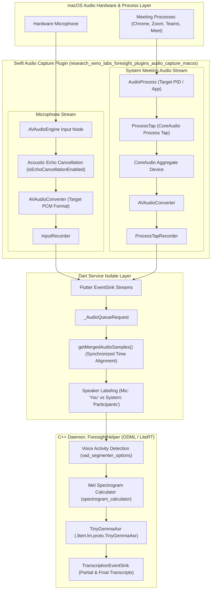

# Reverse Engineering Analysis: Google AI Edge Foresight

**Target Artifacts Analyzed:**
- DMG Image: `foresight_mac.dmg` (160,266,104 bytes)
- App Bundle: `foresight_mac/Foresight.app` (Mach-O 64-bit arm64)
- Main App Executable: `Foresight.app/Contents/MacOS/Foresight` (SHA-256: `fa98b856bfbe9b40cdebfb9f975f7867ec5c0a3ca75b81214a096a60b6db8326`)
- Launch Daemon Helper: `ForesightHelper` (SHA-256: `c96e3fbbd5769932dc5dac04b95a185af06f9e40eb2b51a7168841b7c69c1a0e`)

---

## 1. Deep Dive: Live Transcription, Dual Audio Capture & Model Feeding

Google AI Edge Foresight performs live meeting transcription and speaker-aware question answering completely on-device. A central technical hurdle for live meeting transcription on macOS is capturing both:
1. **The User's Local Microphone** (what the user speaks into the meeting).
2. **The Remote System Audio / Meeting Output** (what other participants speak in Google Meet, Zoom, Microsoft Teams, Slack, etc.).

Below is the concrete reverse-engineered architecture of how Foresight captures, synchronizes, and feeds this dual-stream audio into the on-device transcription model.

---

## 2. Reverse-Engineered Audio Architecture Details

### A. System Meeting Audio Capture: CoreAudio Process Tap & Aggregate Device
* **Plugin Namespace:** `research_xeno_labs_foresight_plugins_audio_capture_macos`
* **Key Classes:** `ProcessTap`, `ProcessTapRecorder`, `AudioProcess`
* **Underlying Apple APIs (macOS 14.2+):**
  Instead of requiring third-party virtual audio kernel extensions or drivers (like BlackHole or Soundflower), Foresight leverages macOS modern **CoreAudio Process Taps**:
  * `AudioHardwareCreateProcessTap`
  * `AudioHardwareCreateAggregateDevice`
  * `AudioDeviceCreateIOProcIDWithBlock`
  * `AudioDeviceStart` / `AudioDeviceStop`
  * `AudioHardwareDestroyProcessTap`
  * `AudioHardwareDestroyAggregateDevice`
* **Mechanism:**
  1. The app identifies active meeting processes via `AudioProcess`.
  2. `ProcessTap` creates a tap on the process audio stream and binds it to a temporary CoreAudio **Aggregate Device** (`aggregateDeviceID`).
  3. Real-time audio buffers are pulled using `AudioDeviceCreateIOProcIDWithBlock`, converted via `AVAudioConverter` into normalized PCM frames, and streamed over Flutter `eventSink`.

### B. User Microphone Capture: `InputRecorder` & Echo Cancellation
* **Class:** `InputRecorder`
* **Underlying Apple APIs:** `AVFoundation`, `AVAudioEngine`, `AVAudioConverter`
* **Echo Cancellation (AEC):**
  * Demangled Swift properties confirm:
    * `InputRecorder.isEchoCancellationEnabled: Bool`
    * Hardware echo cancellation and AGC (Automatic Gain Control) are engaged on the `AVAudioEngine` input node to prevent the microphone from picking up and double-transcribing sound coming out of the Mac's speakers.
  * An audio frame watchdog timer (`tapWatchdogTimeoutMs: Int`) monitors the input stream for hardware dropouts and restarts the engine if an `AVAudioEngineConfigurationChange` notification is posted.

### C. Audio Mixing, Synchronization & Speaker Attribution
* **Dart Isolate Implementation:**
  * Component: `_TranscriptionServiceIsolate` / `OnDeviceSpeechTranscriptionService`
  * Classes recovered from Dart snapshot symbol pool:
    * `_AudioQueueRequest`
    * `_TranscriptionRequest`
    * `_FlushRequest`
    * **`getMergedAudioSamples`**: Interleaves and time-aligns audio frames arriving from `InputRecorder` and `ProcessTapRecorder`.
* **Speaker Separation:**
  * By preserving the channel origin of each chunk before merging, Foresight applies deterministic speaker labeling:
    * Microphone frames $\rightarrow$ `speakerLabelMic` (User / "You").
    * System tap frames $\rightarrow$ `speakerSpotlight` (Meeting Participants).

### D. Audio Preprocessing & Feeding the On-Device Model
* **Daemon Pipeline:** `ForesightHelper` / `odml::audio::transcription`
* **MediaPipe Graph Calculators (code name `drishti`):**
  1. **Voice Activity Detection (VAD):** `vad_segmenter_options` discards silent frames to avoid wasting GPU/NPU cycles.
  2. **Feature Extraction:** `spectrogram_calculator.proto` (`MiniAudioPreprocessorConfig`) transforms the raw 16 kHz PCM stream into **Log-Mel Spectrogram columns** (`kAudioSpectrogramIn`).
  3. **ASR Model:** Processed spectrogram tensors are passed into **`TinyGemmaAsr`** (`.litert.lm.proto.TinyGemmaAsr`) running on **Google LiteRT** (`litert::lm`).
  4. **Output Event Stream:** `odml::audio::transcription::TranscriptionEventLoggingSink` and `TranscriptionEventSink` stream interim (pseudo-streaming) and finalized text back into the UI and RAG embedding store (`transcript_embedding_manager.dart`).

---

## 3. Privacy, Permissions & Consent Management

1. **System Entitlements (`Info.plist`):**
   * `NSAudioCaptureUsageDescription`: *"Please allow access in order to capture audio output from other apps."*
   * `NSMicrophoneUsageDescription`: *"Please allow access to the microphone to capture audio input."*
2. **Mandatory Notification Chimes:**
   * To ensure compliance with two-party consent laws when recording meeting audio, Foresight bundles audio warning chimes in **38+ languages**:
     * `lib/sounds/transcription_notification_*.wav` (e.g., `_en`, `_ja`, `_de`, `_zh_CN`, `_ar`, `_fr`, etc.)
     * `lib/sounds/recorder_warning.wav`
     * `lib/sounds/chime.wav`
   * Text string embedded in binary:
     > *"Before activating assistance from live audio, you are responsible for obtaining consent from all the speakers before activating assistance from live audio."*

---

## 4. REA Evidence Registry

| Component | Evidence ID / Symbol | Verification Note |
| :--- | :--- | :--- |
| **CoreAudio Process Tap** | `_AudioHardwareCreateProcessTap` | Native tap without third-party virtual audio driver |
| **Aggregate Device** | `_AudioHardwareCreateAggregateDevice` | Creates synchronized multi-input CoreAudio virtual device |
| **Microphone AEC** | `InputRecorderC25isEchoCancellationEnabledSb` | Echo cancellation preventing speaker feedback loop |
| **Dart Frame Merger** | `_AudioQueueRequest.getMergedAudioSamples` | Time-aligns mic and system PCM frames |
| **ASR Inference** | `TinyGemmaAsr` / `kAudioSpectrogramIn` | MediaPipe spectrograms fed to LiteRT on-device ASR |
| **Audio Notification** | `lib/sounds/transcription_notification.wav` | 38+ language bundled compliance warning sounds |
