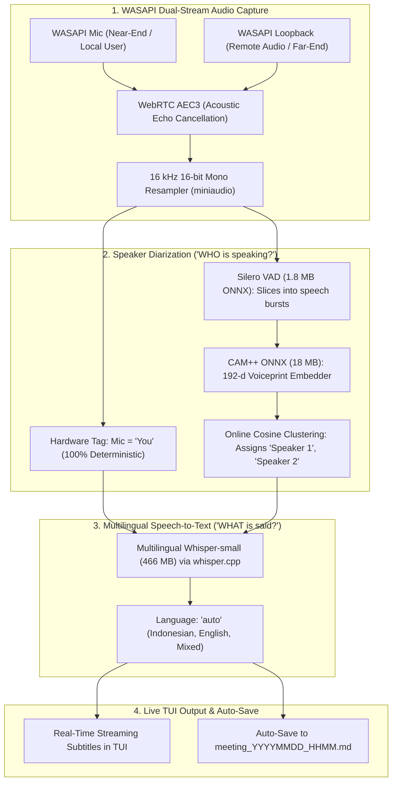

# Catetin: Production Architecture Plan (TUI + Config-Driven)

**Project:** **Catetin** (`catetin`) — *"Tolong catetin rapat ini ya!"*

**Core Principles:**
1. **100% Offline Core Engine:** Live Audio Capture $\rightarrow$ Voice Activity Detection $\rightarrow$ Speaker Diarization $\rightarrow$ Multilingual Speech-to-Text (**Zero LLM Required, ~485 MB total models**).
2. **Resource Footprint:** Ultra-lean (< 400 MB RAM, < 5% CPU, silent laptop fans, hours of battery).
3. **Bilingual Support:** Native English, Indonesian (Bahasa Indonesia), and mixed code-switching (*Bahasa gado-gado*).
4. **Config-Driven Layout:** The assistant / right pane is **configured via `config.toml`** (default: `show_assistant = false`). No in-call screen switching or runtime `F2` toggling—the TUI opens directly in clean full-width transcript mode unless explicitly enabled in configuration.

---

## 1. Configuration-Driven Architecture (`config.toml`)

All UI layouts and assistant options are defined in the user's config file (`%APPDATA%\catetin\config.toml` on Windows, or `~/.config/catetin/config.toml` on Linux/Android):

```toml
# %APPDATA%\catetin\config.toml

[ui]
# Set to false (default) for clean, distraction-free full-width live transcript.
# Set to true only if you want the split-view assistant pane.
show_assistant = false

[audio]
sample_rate = 16000
enable_aec = true               # WebRTC Acoustic Echo Cancellation
language = "auto"              # Auto-detects English & Indonesian

[assistant]
# Ignored when show_assistant = false (0% CPU/GPU overhead)
provider = "none"              # "none" | "cloud" | "local" | "ollama"

# Cloud Option (Optional: offloads compute from laptop)
[cloud]
provider = "groq"              # "groq" | "gemini" | "openai" | "deepseek"
api_key = "gsk_..."            # Or via GROQ_API_KEY environment variable
model = "llama-3.3-70b-versatile"
base_url = "https://api.groq.com/openai/v1"

# Local Option (Optional: if user prefers 100% offline local model)
[local]
model_path = "models/llama-3.2-1b-instruct.Q4_K_M.gguf"
threads = 4
```

### CLI Commands:
* `catetin` $\rightarrow$ Runs with settings from `config.toml` (defaults to pure transcript mode).
* `catetin --assistant` $\rightarrow$ Forces the assistant pane open for this meeting.
* `catetin config set ui.show_assistant true` $\rightarrow$ Updates config preference permanently.

---

## 2. Terminal UI Layouts

### Default View: Pure Full-Width Transcript (`show_assistant = false`)
Clean, distraction-free terminal layout:

```
┌─ Catetin v1.0 [100% OFFLINE] ───────────────────────────────────────────────────────────────────┐
│ Audio: [●] Mic | [●] Loopback (WASAPI) │ Lang: [Auto: ID/EN] │ ASR: [whisper-small] │ RAM: 340 MB │
├─────────────────────────────────────────────────────────────────────────────────────────────────┤
│                                                                                                 │
│ [10:02:15] [You]:                                                                               │
│   "Halo semuanya, selamat pagi. Hari ini kita bahas release Q4 ya."                             │
│                                                                                                 │
│ [10:02:22] [Speaker 1] (Remote):                                                                │
│   "Pagi! Deck presentation sudah siap, tinggal finalisasi budget slide."                        │
│                                                                                                 │
│ [10:02:35] [Speaker 2] (Remote):                                                                │
│   "I've updated the Figma mockups. I'll share the link in the chat right now."                  │
│                                                                                                 │
│ [10:02:48] [You]:                                                                               │
│   "Thanks Alice. Tolong budget-nya difinalkan sebelum jam 3 sore ya."                           │
│                                                                                                 │
│ [10:03:02] [Speaker 1] (Remote):                                                                │
│   "Siap, noted."                                                                                │
│                                                                                                 │
├─────────────────────────────────────────────────────────────────────────────────────────────────┤
│ [Space] Pause/Resume  │ [c] Save Markdown  │ [o] Audio Settings  │ [q] Quit                     │
└─────────────────────────────────────────────────────────────────────────────────────────────────┘
```

---

### Alternate View: Assistant Enabled (`show_assistant = true`)
Loaded only when configured in `config.toml` or launched with `catetin --assistant`:

```
┌─ Catetin ───────────────────────────────────────────────────────────────────────────────────────┐
│ Audio: [●] Mic | [●] Loopback │ Lang: [Auto: ID/EN] │ Assistant: [Cloud: Groq Llama-3.3]        │
├────────────────────────────────────────────────┬────────────────────────────────────────────────┤
│ LIVE DIARIZED TRANSCRIPT                       │ LIVE SUMMARY & ACTION ITEMS                    │
│                                                │                                                │
│ [10:02:15] [You]:                              │ • Key Decisions:                               │
│   "Halo semuanya, selamat pagi..."             │   - Release Q4 roadmap approved                │
│                                                │                                                │
│ [10:02:22] [Speaker 1] (Remote):               │ • Action Items:                                │
│   "Deck presentation sudah siap..."            │   [ ] Speaker 1: Finalize budget slide by 15:00│
│                                                │   [ ] Speaker 2: Share Figma mockup link       │
│ [10:02:35] [Speaker 2] (Remote):               │                                                │
│   "I've updated the Figma mockups..."          ├────────────────────────────────────────────────┤
│                                                │ ASK ASSISTANT (Enter to send)                  │
│                                                │                                                │
│                                                │ > Jam berapa budget harus selesai?             │
│                                                │ Budget harus difinalkan sebelum jam 15:00 sore.│
├────────────────────────────────────────────────┴────────────────────────────────────────────────┤
│ [Space] Pause/Resume  │ [s] Refresh Summary  │ [c] Save Notes  │ [Tab] Switch Box  │ [q] Quit   │
└─────────────────────────────────────────────────────────────────────────────────────────────────┘
```

---

## 3. Core Engine Pipeline (Audio $\rightarrow$ Diarization $\rightarrow$ Whisper)

Runs 100% locally on your machine with zero cloud connectivity:



### Core Specifications:
* **Models Required:**
  * `silero_vad.onnx`: **1.8 MB** (filters silence and speech pauses).
  * `cam++_voiceprint.onnx`: **18 MB** (language-agnostic acoustic voiceprint clustering).
  * `ggml-whisper-small.bin`: **466 MB** (multilingual English, Indonesian, and mixed speech).
* **Total Core Size:** **~485 MB total**.
* **RAM / CPU Impact:** **< 350 MB RAM, < 5% CPU**.
